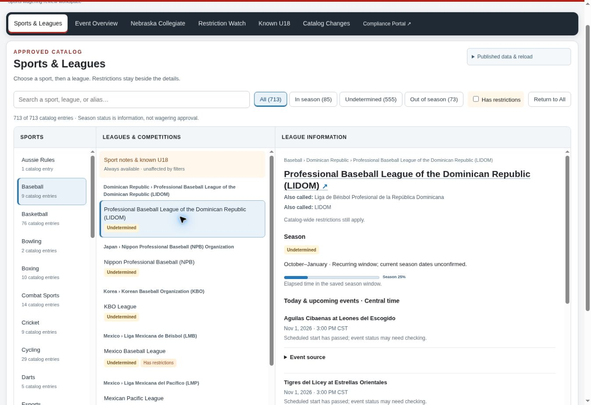

# Catalog workspace review

Prepared November 2, 2026. **Layout implemented and locally tested; data coverage improvement remains blocked. Nothing merged or deployed.**

## Access, baseline and connected systems

Current files were read in all three connected repositories. Private repository files were materialized through the authenticated GitHub connector and verified against their Git blob hashes. A private shell clone was unavailable, but connector read access was sufficient; no additional repository connection is needed for this review.

| Repository | Inspected branch / revision | Deployed or published baseline |
| --- | --- | --- |
| `cornhskr1/active-offerings-review` | `main` / `daebbc1a589d642c15f0199fab571e6ccd855529` | GitHub Pages deployment run `41386794460`; live immutable manifest identifies this app revision |
| `cornhskr1/wagering-compliance-portal` | `main` / `a0561305279b1ad2c26db1dded9e0849bdcda79c` | Cloudflare Pages successful deployment check `6a6a8f1d-a022-4db9-a8a1-afeea2c584af`; production sign-in boundary unchanged |
| `cornhskr1/active-offerings-data` | `main` / `8603fc73c1469bc6dcd10549d522ca5bf79f51e1` | Same data revision in the live immutable public manifest; 31 published file hashes verified |

The data contract records app revision `163825d4b46ea9af2869c29c6c2103b03f51ea15`. The live data manifest SHA-256 is `b8b94e301f2d4b005804945759935447d48f76e59e2522fc3f97993d3ae5712e`. The inspected global schedule was generated `2026-11-01T23:33:00.634258+00:00`.

The private data publisher is active despite older documentation describing an inactive migration. Its workflows publish data used by the public app. The compliance portal separately syncs a seven-file immutable public reference bundle: approved catalog, season map, competition identity registry, known U18, tennis U18 registry, tennis age evidence and Nebraska collegiate schedules. Its transaction inputs, private operator aliases, learning decisions and session mappings stay inside the portal boundary. The new presentation code is not consumed by that sync or its decision engine.

Open work was checked before implementation and again before the review branch was prepared. App draft PR #249 is an existing, explicitly unverified basketball-discovery experiment and was left untouched. The other two repositories had no open PRs. Recent SharpAPI/API-SPORTS connection work was already merged and was not duplicated. The three main revisions remained unchanged at the final read.

## Existing capabilities and destination

| Original view | Retained capability and destination |
| --- | --- |
| Review Today | Attention alerts, date/sport event boards, source observations and reload status retained in **Event Overview**. Exact league-matched events and existing alerts also appear in Sports & Leagues. Publication and reload details are accessible from the catalog header. |
| Nebraska Collegiate | Separate view retained: school/location filters, calendar evidence, location test, stale labels, futures cutoffs and rules. |
| Restriction Watch | Catalog-wide standards, full sport notes, exact market wording and existing restriction search retained. Relevant rules also appear directly beside the selected league. |
| Known U18 | Original age registry and NCAA age-intelligence views retained. Current U18 and uncertain records are also accessible under each sport, regardless of presentation filters. |
| Catalog Changes | Intake, review holds, original/changed lines and safeguards retained. |
| Approved Catalog & Coverage | Replaced as the default screen by Sports & Leagues. The original full catalog, Olympic programs, hierarchy, health and source details remain in an expandable section. |

The removed long navigation guide had no independent function or data. No unrelated portal features were rebuilt.

## Implemented behavior

- One page with Sports, Leagues & Competitions and League Information columns. Catalog country, governing-body, category, edition and child distinctions are preserved. All is the default.
- 713 displayed catalog entries: 661 mapped parents plus 52 Olympic edition/catalog entries. These are not the same counting unit as the 733 operational identities, which include separately tracked children. All mapped parents and children remain available, and original catalog text remains lossless and accessible.
- All / In season / Undetermined / Out of season buttons with counts; independent Has restrictions filter; alias search; Return to All clears both filters and search. At the baseline date the display partition was 85 / 555 / 73.
- Official names and published aliases, including operator labels only when supported by evidence. Child aliases keep their scope. Private portal aliases and saved mappings were **not copied into the public app**. Broader private operator-alias display would require an authenticated integration; that is outside this layout change.
- Exact saved restriction wording and notes are visible in the detail panel. Season labels use blue, amber and gray and are explicitly separate from wagering approval.
- Full dated season windows remain usable when an event source is empty, missing or held. Recurring month/day windows are labeled as unconfirmed current dates. Partial, mixed, held or unverified seasons stay Undetermined. Presentation classification does not modify the existing shared season rules or saved evidence.
- Existing season progress bars retain their original calculations and values and are labeled as elapsed time in the saved window. They do not measure review completion. Legacy source details preserve the original saved-window display.
- Existing exact-matched event observations show matchup, date, Central time and source date. `America/Chicago` handles DST. Date-only observations say Time not published; ambiguous times are not fabricated. Reference windows are not presented as individual matchups. Five events are visible initially, with the remainder expanding in place.
- Every current age record remains accessible under its sport. A league placement requires an explicit verified, evidenced catalog relationship. Unmapped records are not guessed into leagues. Age evidence, uncertainty, source dates and the existing age-decision logic remain intact. The 25 verified adults remain in retained evidence for historical screening; the current view contains 79 U18/uncertain records from 104 durable records at the baseline date.
- Desktop is the primary layout. At 390 pixels the columns stack, sports and leagues remain scrollable, and no horizontal page overflow was observed.



## Data coverage: unchanged, measured separately

Observation time: `2026-11-02T05:00:00Z`, corresponding to November 1, 11 p.m. Central Standard Time. Review dates: November 1–8. Counts use the existing coverage model against the verified published snapshot.

| Measure | Baseline | After this change |
| --- | ---: | ---: |
| Operational catalog identities | 733 | 733 |
| Active route matches | 192 | 192 |
| Identities with current fixtures | 69 | 69 |
| Distinct current fixtures | 330 | 330 |
| Identities without current fixtures | 664 | 664 |
| Healthy source with no returned events | 105 | 105 |
| Reference-only identities | 315 | 315 |
| Inactive / unknown identities | 18 | 18 |
| Unmapped identities | 226 | 226 |
| **Additional competitions with new usable season/event information** | — | **0** |

The 337 events in the complete review model include other review observations and reference rows; they are not all fresh, usable fixture records. A successful empty response is not proof of Out of season. Source route matching, date evidence and fixture coverage remain separate measures.

The retained snapshot contains **161 ESPN source records linked to 161 operational identity routes**. This does not validate the earlier roughly 60% estimate against today's catalog, and it is not schedule coverage. ESPN stays disconnected. All 178 recorded publisher holds, the existing Odds API halt, age controls and zero-quota limits are unchanged.

The [complete missing-competition queue](missing-competitions.csv) covers all 664 gaps, sorting confirmed In season first. [Detailed evidence](coverage-baseline.json) includes season dates, verification dates, permission holds and source observations. It is a review queue, not permission to collect. First in-season gaps include BBL-Pokal, FIBA 3x3 World Tour, FIBA Basketball World Cup, Women's EuroLeague, Ignite Cup, King Mindaugas Cup, SBL and Swiss Cup. Check a permitted current-edition source for each; a held route must stay held, and an empty route must not be treated as season evidence.

| Evaluated source | Actual retained integration | What remains unverified / blocked |
| --- | --- | --- |
| SharpAPI (`sharpapi.io`) | Existing merged, bounded NBA/NFL capability preflight; maximum account + one events-page request, no odds, no pagination and a saved 24-hour attempt guard. | No authenticated preflight result is present in the inspected published snapshot. Current season, exact phase, complete sample and use-specific publication permission are not established. It emits zero fixtures while pending. NBA/NFL access would not establish coverage of the missing international leagues. |
| API-SPORTS NBA | Existing merged `/games?league=standard&season=2026` free-plan capability check; one request per saved 24-hour guard, daily quota validation. | No authenticated result is retained yet. Current-season entitlement, exact team/phase mapping and intended-use rights must be established before fixture activation. Advertised API coverage is insufficient. |
| API-FOOTBALL / other API-SPORTS families | Retained mappings and earlier investigation were inspected; no new subscription or source was activated. | Free access has restricted seasons. A catalog match does not prove the account can return the current edition. The inspected snapshot has no verified current usable schedule from a newly activated free route. Publication rights require separate review. |

Official references checked November 2: [SharpAPI terms](https://sharpapi.io/terms), [API-SPORTS terms](https://api-sports.io/terms), [API-FOOTBALL free-plan limits](https://www.api-football.com/pricing). API-SPORTS explicitly does not supply a publication license. SharpAPI permits internal tools but restricts redistribution; treating the publicly hosted staff screen as a permitted internal use would require use-specific confirmation. No permission was inferred from public accessibility.

The next evidence to inspect is the already authorized normal collector's bounded preflight result. No manual provider requests, paid-source resume, quota increase, collection-hold removal or staff schedule-entry workaround was introduced. Secrets remain in the existing workflow environment; none were requested, read back or exposed. The pending response and rights checks prevent a truthful claim of new current schedule coverage in this delivery.

## Verification

| Check | Result |
| --- | --- |
| App baseline suite | 1,353 tests, passing; one existing skip |
| App revised full suite | 1,366 tests, passing; one existing skip |
| Revised dashboard check | 99 tests, passing, including 13 new catalog-workspace tests |
| Portal baseline/full regression | 727 tests: 726 passed, one existing skip |
| Portal saved gold cases | 21/21 passed across Kambi, IGT and Caesars |
| Portal final audit/release gate | Passed with the existing U18 reference-review-due advisory |
| Same-input decision comparison | Identical before/after: 337 events, 104 age-evidence records, 48 restrictions, 661 season-progress entries, five red and 196 amber review items |
| Private source integrity | All 174 portal and 124 data-repository source files match the inspected Git blobs after testing |
| Catalog/age retention | Every mapped parent and child retained; source catalog wording retained; every current age record reachable; no input mutations |
| Desktop browser workflow | Sport → league → details; aliases/restrictions; events expansion; season and restriction filters; alias search and Return to All; real season-progress values; U18 access while filtered |
| Nebraska browser workflow | Separate view; Nebraska school and outside-Nebraska filters; calendar freshness and futures evidence retained |
| Mobile browser check | 390-pixel iframe: stacked layout, alias search, readable restriction/detail panel, no horizontal overflow |
| Portal browser smoke check | Local synthetic nine-row demonstration loads and screens to seven wagers with three restriction-review items; no real reports used |

Gold and regression coverage includes catalog approval, market restrictions, U18/uncertain ages, Nebraska controls, adversarial/ambiguous aliases, saved learning/mapping boundaries and missing/stale references. Existing portal decision and reference files are byte-identical, not a rewritten equivalent engine.

These are **local tests and local browser checks**. Production deployment metadata and published data hashes were verified read-only. The revised UI has not been deployed, production authenticated screening has not been exercised, and no live provider response was obtained. The mobile check is responsive-layout testing, not a physical-device test.

Reproduce against an unchanged saved published snapshot:

```sh
python -m unittest discover -s tests -q
python scripts/verify_catalog_workspace_invariants.py daebbc1a589d642c15f0199fab571e6ccd855529 /path/to/snapshot 2026-11-02T05:00:00Z
node scripts/report_catalog_workspace_coverage.js /path/to/snapshot 2026-11-02T05:00:00Z
```

The [decision comparison receipt](decision-invariants.json) records digest `1e618ddc2d1606520f0066b3ddc0cc9d64d89ce35433e8574e7918a318451f1f`. The scripts are offline and read-only. The existing dashboard CI workflow also runs the new tests and syntax checks.

## Approval and rollback

Review the isolated branch and draft PR before merge. No changes are proposed in the private portal or data repository. The app change consists of presentation code, an added read of the existing published identity registry, tests, read-only audit scripts and documentation. Only the dashboard verification workflow changes; collection, publication and deployment workflows do not.

Before an approved merge, require green PR checks, recheck that `main` has not advanced unexpectedly, and rerun the comparison against the intended published snapshot if source data or logic changes. Merging to `main` starts the existing deployment workflow, so merge approval also needs to account for that automatic deployment.

If the approved release needs rollback, revert this presentation PR in `active-offerings-review` and redeploy through the existing Pages workflow. Preserve newer unrelated commits and current published evidence; do not reset the private data branch, reverse catalog/age decisions, restore stale source data or change any hold. The inspected app revision above is the known prior UI. Verify its source/data manifest, reload the public app, and rerun the same-input comparison. No data migration, account change or portal rollback is required.
